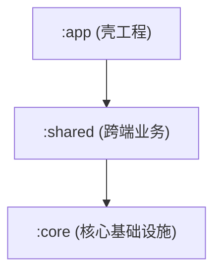

# 准则六：项目与模块架构文档维护规约 (Project & Module Documentation Policy)

## 1. 核心原则

### 1. 双层架构文档体系 (Root & Module Level)
工程文档分为**工程根目录总览文档**与**子模块级文档**，二者各司其职，必须严格维护：

1. **工程根目录总览 `README.md`**：
   * **全局架构概览**：必须包含系统整体架构设计、技术栈版本、跨端/多模块依赖拓扑图（推荐使用 Mermaid 流程图/拓扑图）；
   * **模块索引表**：清晰列出所有子模块的名称、路径及核心职责；
   * **快速构建指南**：提供环境要求（JDK/Node/SDK版本）与快速构建运行命令。
2. **子模块级 `README.md`**：
   * **独立模块必须维护**：凡拥有独立构建脚本（如 `build.gradle.kts` / `pom.xml` / `package.json` / `CMakeLists.txt`）的模块根目录下，必须建立并维护 `README.md`；
   * **记录目录分层与职责**：清晰记录该模块内的目录分层、各文件的核心职责、算法与渲染器架构、核心数据流与交互依赖关系。

---

### 2. 深度技术文档归档规约 (`docs/explain/`)
* 凡针对特定功能、算法演进、性能瓶颈调优或深度架构设计的技术分析与总结文档，统一输出至对应模块的 `docs/explain/` 目录下（如 `shared/docs/explain/`），严禁散落在未约定的目录中。

---

### 3. 代码变更与文档同次任务同步铁律
* 凡在模块内进行**新增、重命名、移动、拆分或删除**文件，或对关键文件的职责边界做出重大调整，**必须在同一次任务/变更中同步更新对应模块根目录下的 `README.md`**，杜绝代码结构与文档说明脱节腐化。

---

## 2. 工程根目录与模块级 README 结构模板

### 模板 A：工程根目录总览 `README.md` 结构
```markdown
# 项目名称 (Project Name)

## 1. 项目定位与业务目标
[简述本项目的业务背景与核心功能]

## 2. 全局架构拓扑图


## 3. 技术栈与环境要求
* **语言与版本**：Kotlin 2.x / Java 17 / ...
* **构建系统**：Gradle 8.x / AGP 8.x

## 4. 模块结构索引
| 模块名称 | 路径 | 核心职责 |
| :--- | :--- | :--- |
| `:shared` | `shared/` | 跨端业务逻辑与 UI 渲染 |
| `:androidApp` | `androidApp/` | Android 原生入口壳工程 |

## 5. 快速构建与运行
[构建、运行与调试命令]
```

---

### 模板 B：子模块级 `README.md` 结构
```markdown
# 模块名称 (`:module-name`)

## 1. 模块定位与职责
[简要概述本模块在整个工程中的定位与业务边界]

## 2. 目录架构与核心文件职责表
- `ui/`: 界面组件层
  - `XxxPage.kt`: 核心页面容器，负责状态收集与事件转发
  - `XxxCard.kt`: 局部卡片展示组件
- `model/`: 数据与状态模型
  - `XxxState.kt`: 不可变 UI 状态定义
- `util/`: 纯函数与辅助扩展

## 3. 核心数据流与交互设计
[说明组件与状态流转机制，必要时附带数据流转图]
```
